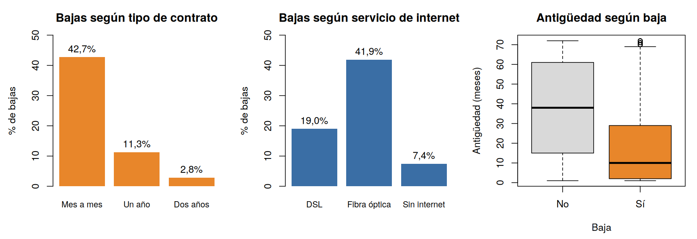
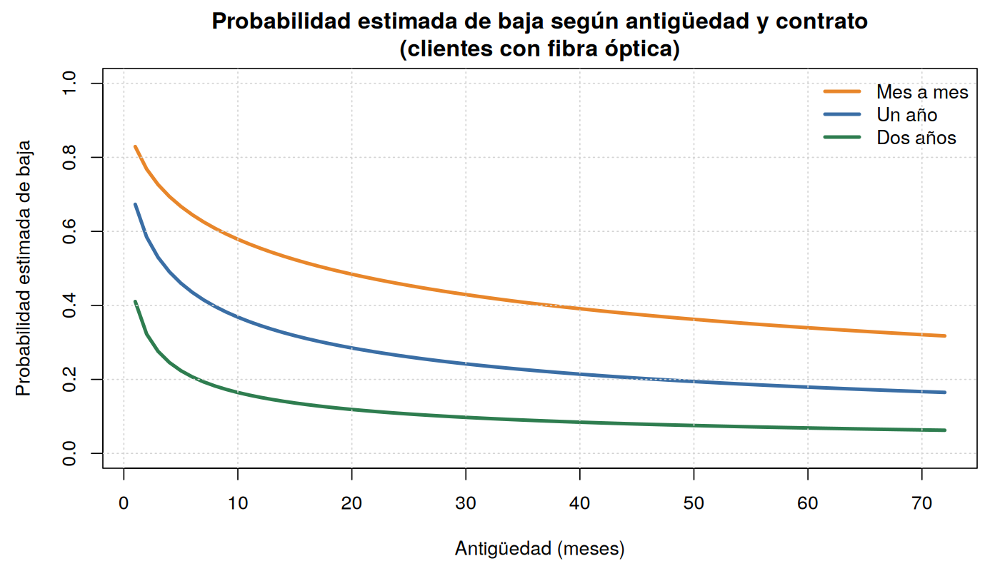
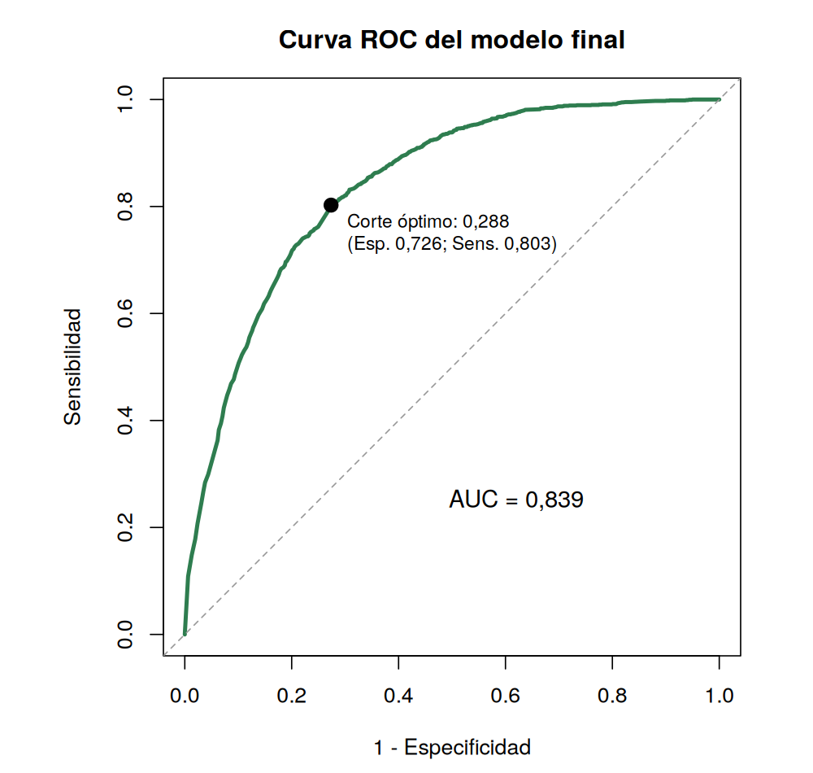

# ¿Qué clientes se van? Baja de clientes en una empresa de telecomunicaciones

**Regresión logística** · R (`pROC`, `caret`, `ResourceSelection`, `statmod`) · Modelos Lineales Generalizados, Lic. en Estadística (UNR) · 2026
Trabajo en equipo: Shirli Kierzkowski y Pía Denipotti.

## Pregunta
¿Cómo influyen la antigüedad, el tipo de contrato y el servicio de internet en la probabilidad de que un cliente se dé de baja? ¿Se puede anticipar quién se va a ir?

## Datos
*Telco Customer Churn* (Kaggle): 7.043 clientes. Se excluyeron 11 con antigüedad 0, así que se analizaron **7.032 clientes**, de los cuales **1.869 (26,6 %) se dieron de baja**.

## Método
1. **Regresión logística** con antigüedad, tipo de contrato y servicio de internet; se evaluaron las interacciones con tests de razón de verosimilitud (ninguna resultó significativa).
2. El efecto de la antigüedad **no es lineal**: se compararon transformaciones (lineal, logarítmica, polinómica y categorizada) por AIC y BIC, y la **logarítmica** fue la mejor.
3. **Bondad de ajuste:** test de Hosmer-Lemeshow (p = 0,48), test de la función de enlace, residuos cuantil y distancia de Cook (no hay observaciones influyentes).
4. **Capacidad predictiva:** curva ROC, punto de corte óptimo (índice de Youden) y **validación cruzada estratificada de 10 particiones**, eligiendo el corte en cada entrenamiento para no sobreestimar el desempeño.

## Resultados
| Variable | Razón de odds | IC 95 % |
|---|---|---|
| Duplicar la antigüedad | 0,68 | 0,66 – 0,71 |
| Contrato de un año (vs. mes a mes) | 0,42 | 0,35 – 0,52 |
| Contrato de dos años (vs. mes a mes) | 0,14 | 0,11 – 0,20 |
| Fibra óptica (vs. DSL) | 3,49 | 3,01 – 4,03 |
| Sin internet (vs. DSL) | 0,31 | 0,25 – 0,40 |

- **Los primeros meses son críticos:** duplicar la antigüedad reduce un 32 % la chance de baja, así que un mes extra pesa mucho más al principio de la relación que después.
- Los **contratos largos protegen**: un contrato de dos años reduce la chance de baja un 86 % respecto del mes a mes.
- Los clientes con **fibra óptica** tienen 3,5 veces más chance de irse que los de DSL, una señal para revisar precio o calidad de ese servicio.
- Un cliente **nuevo, mes a mes y con fibra óptica** tiene una probabilidad estimada de baja del **83 %**: es el perfil prioritario para retención.

**Capacidad predictiva (validación cruzada):** AUC = 0,84; con el corte óptimo (≈ 0,29) el modelo **detecta al 80 % de los clientes que se dan de baja**, con 72 % de especificidad. Con el corte habitual de 0,5 solo detectaría al 47 %.

## Archivos
- `codigo/modelo_churn.R`: análisis completo.
- `datos/telco_churn.csv`
- `informe.pdf`: informe completo.
