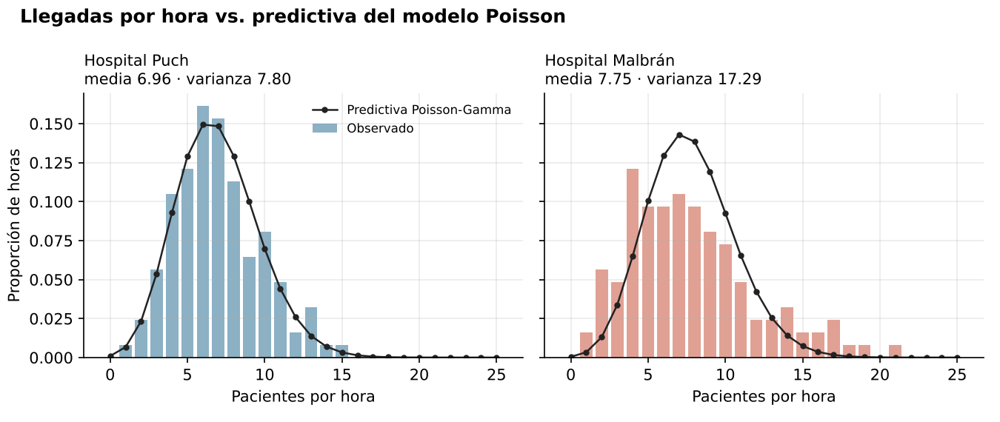

# Demanda en guardias hospitalarias: ¿cuántos médicos hacen falta?

**Modelos bayesianos para conteos + MCMC programado a mano** · R (`coda`, `mvtnorm`, `ggplot2`) · Estadística Bayesiana, Lic. en Estadística (UNR) · 2026 · Trabajo en equipo

## Pregunta
Con las llegadas registradas a la guardia de dos hospitales (124 horas observadas en cada uno, febrero–abril), ¿cuántos pacientes se esperan por hora y cuántos médicos conviene asignar (1 médico cada 3 pacientes)?

## Método
1. **Modelo Poisson-Gamma** para las llegadas por hora: posterior y predictiva exactas.
2. **Metropolis-Hastings implementado desde cero** (4 cadenas, burn-in, R̂ de Gelman-Rubin y tamaño efectivo de muestra), validado contra la posterior analítica; versión reparametrizada en escala logarítmica.
3. **Chequeos predictivos a posteriori** en ambos hospitales.
4. El Hospital Malbrán muestra **sobredispersión** (varianza > media), así que se pasa a un modelo **Binomial Negativo** con dos parámetros (μ, φ), estimado con un MCMC bivariado.
5. Distribución a posteriori de la **cantidad de médicos necesarios** por hora en cada hospital.

## Resultados
| | Hospital Puch | Hospital Malbrán |
|---|---|---|
| Pacientes por hora (media) | 6,96 | 7,75 |
| Varianza | 7,80 | 17,29 |
| P(llegan 10 o más en una hora) | 0,17 | 0,26 |

- En Puch, el modelo Poisson ajusta bien (media ≈ varianza); el MCMC reproduce la solución exacta (P(5 ≤ Y ≤ 10) = 0,726 analítico vs. 0,727 MCMC).
- En Malbrán, la varianza duplica a la media: el Poisson subestima las horas de mucha demanda, y el Binomial Negativo las captura. Por eso Malbrán necesita **más margen de médicos** en las horas pico aunque la media sea parecida.

## Archivos
- `codigo/demanda_guardias.R`
- `datos/llegadas_hospital_puch.csv`, `datos/llegadas_hospital_malbran.csv` (datos provistos por la cátedra)
