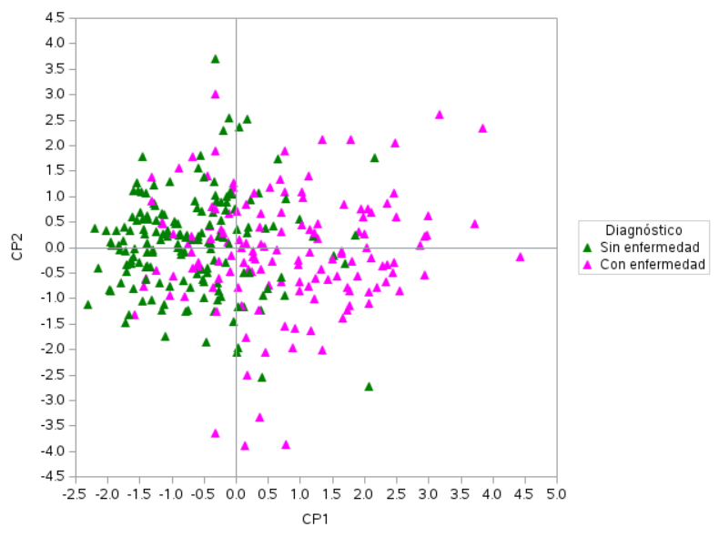
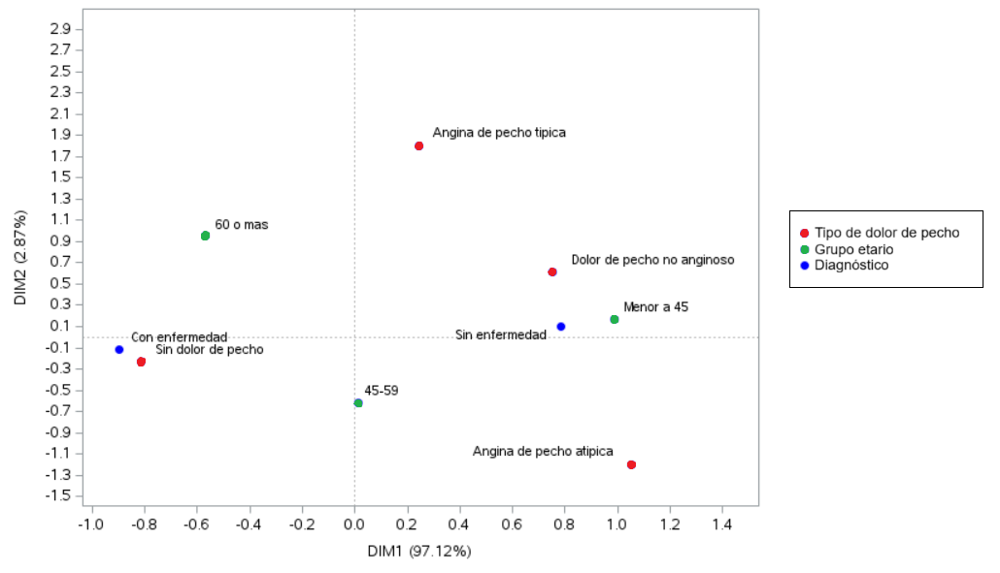

# Factores asociados a las enfermedades cardiovasculares

**Análisis multivariado** · SAS (`PROC PRINCOMP`, `PROC CORRESP`, `PROC STEPDISC`, `PROC DISCRIM`) · Análisis de Datos Multivariados, Lic. en Estadística (UNR) · 2025
Trabajo en equipo: Pía Denipotti y Shirli Kierzkowski.

## Pregunta
¿En qué se diferencian los pacientes con y sin enfermedad cardiovascular, qué perfiles de riesgo aparecen y se puede construir una regla simple para clasificarlos?

## Datos
*Heart Disease Data Set* (UCI): 309 pacientes de Cleveland, Hungría, Suiza y Long Beach, con mediciones clínicas y de pruebas de esfuerzo.

## Método y resultados
**1. Componentes principales** sobre presión arterial, colesterol, vasos coloreados, frecuencia cardíaca máxima y depresión del segmento ST. Se retienen 3 componentes (73 % de la varianza). La primera, *respuesta patológica al esfuerzo*, separa claramente a los pacientes enfermos; colesterol y presión en reposo no los distinguen.

**2. Análisis de correspondencias múltiples** entre diagnóstico, grupo de edad y tipo de dolor de pecho. La primera dimensión (97 % de la inercia) es un eje *salud–enfermedad*: la enfermedad se asocia a **mayores de 60 años y a pacientes sin dolor de pecho** (isquemia silenciosa), mientras que los menores de 45 con angina atípica se asocian a la ausencia de enfermedad.

**3. Análisis discriminante lineal** con selección paso a paso (depresión ST, vasos coloreados y frecuencia cardíaca máxima). MANOVA: Λ de Wilks = 0,65, p < 0,0001.
Regla: `W(x) = 3,57 + 0,63·ST + 1,06·vasos − 0,03·frec_max` → "con enfermedad" si W > 0.
**Exactitud en validación cruzada: 77 %** (sensibilidad 71 %, especificidad 83 %).

## Mejora pendiente
En los registros de Suiza y Long Beach el colesterol faltante figura como 0; conviene tratarlo como dato faltante antes del ACP.

## Archivos
- `codigo/analisis_multivariado.sas`
- `datos/heart_disease_uci.csv`
- `informe.pdf`: informe completo.
