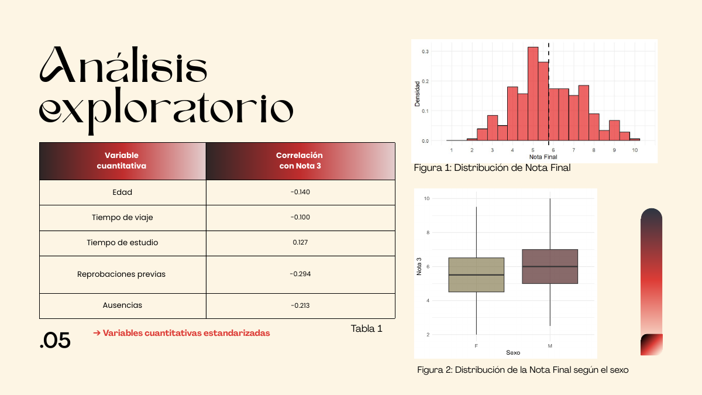
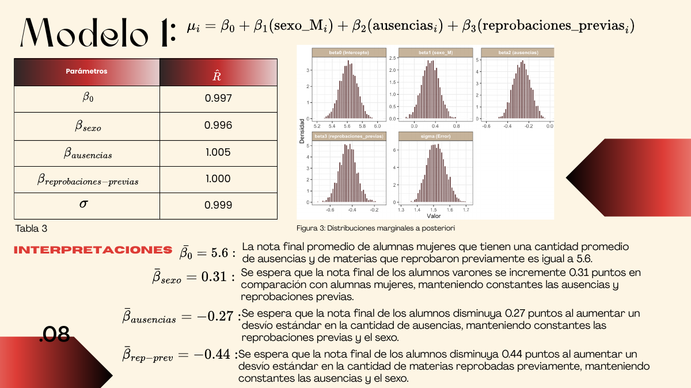
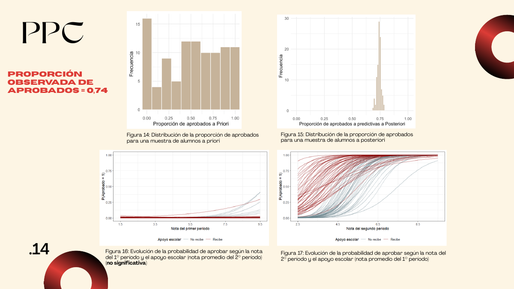

# Modelado predictivo del rendimiento académico (enfoque bayesiano)

**Regresión bayesiana** · R + Stan (`rstan`, `loo`, `bayesplot`) · Estadística Bayesiana, Lic. en Estadística (UNR) · 2026
Trabajo en equipo: Lucía Abatedaga, M. Eugenia Mogetta y Pía Denipotti.

## Pregunta
¿Qué factores personales, familiares, sociales y escolares se asocian a la nota final de un curso? ¿Cuánto cambia la capacidad predictiva cuando se suman las notas parciales del año?

## Datos
Adaptación del dataset público *Student Performance* (UCI): 395 estudiantes con 33 variables. Se eliminaron 38 registros inconsistentes (nota final = 0 sin ausencias), quedando **357 estudiantes**.

## Método
- **Regresión lineal normal bayesiana** escrita en Stan, con priors débilmente informativos y variables estandarizadas.
- **Comparación de modelos por validación cruzada** (PSIS-LOO / ELPD) para elegir un modelo parsimonioso.
- **Chequeos predictivos** a priori y a posteriori, y diagnóstico de convergencia (R̂ ≈ 1).
- **Regresión logística jerárquica** para la probabilidad de aprobar, con coeficientes distintos según si el estudiante recibe apoyo escolar.

## Resultados
| Modelo | Variables | ELPD-LOO |
|---|---|---|
| M1 (sin notas previas) | sexo, ausencias, reprobaciones previas | −656,8 |
| M2 (trayectoria) | nota del 1.º y 2.º período | −193,8 |

- **Sin notas previas**, el rendimiento se explica sobre todo por las **reprobaciones previas** (−0,44 puntos por desvío estándar) y las **ausencias** (−0,27); los varones obtienen en promedio 0,31 puntos más.
- **Con las notas del año**, la capacidad predictiva mejora enormemente; casi toda la información la aporta la nota del 2.º período.
- En la logística, un desvío estándar más en la nota del 2.º período multiplica la chance de aprobar por ≈ 8,9 en quienes no reciben apoyo escolar y por ≈ 4,7 en quienes sí lo reciben.

## Archivos
- `codigo/modelos_bayesianos.R`: exploración, ajuste, comparación y chequeos.
- `datos/notas_estadistica.csv`
- `presentacion.pdf`: presentación completa del trabajo.
