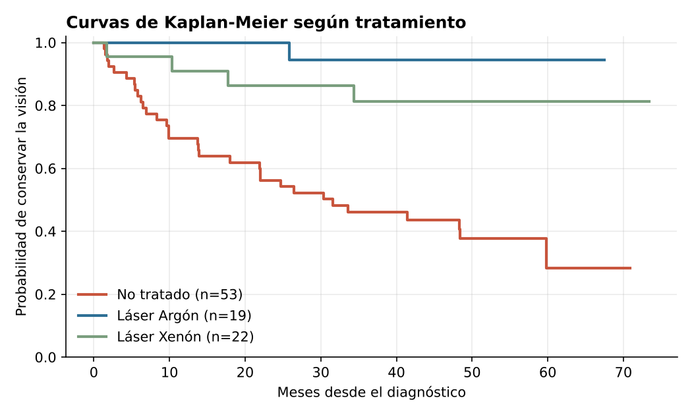

# Tiempo hasta la ceguera en retinopatía diabética

**Análisis de supervivencia** · R (`survival`, `survminer`) · Análisis de Datos de Duración, Lic. en Estadística (UNR) · 2026
Trabajo en equipo: M. Eugenia Mogetta, Emilia Díaz Romero y Pía Denipotti.

## Pregunta
¿Cuánto retrasa la fotocoagulación con láser la pérdida de visión en pacientes con diabetes de larga evolución? ¿Hay diferencias entre el láser de Argón y el de Xenón?

## Datos
Muestra de un centro de atención del estudio de retinopatía diabética (dataset `retinopathy`, paquete `survival` de R). El archivo trae 26 filas duplicadas; luego de eliminarlas quedan **94 ojos**, con **60,6 % de observaciones censuradas**.

## Método
1. Curvas de **Kaplan-Meier** por tratamiento y **test log-rank**.
2. **Modelo de riesgos proporcionales de Cox**, con selección de variables por test de razón de verosimilitud (edad, puntaje de riesgo, tratamiento e interacciones) y evaluación de la linealidad del puntaje de riesgo.
3. Verificación del supuesto de **riesgos proporcionales** con residuos de Schoenfeld (p global = 0,57).
4. Curvas de supervivencia ajustadas para un paciente típico (riesgo = 9).

## Resultados
Modelo final: `h(t) = h0(t) · exp(β1·riesgo + β2·Argón + β3·Xenón)`

| Comparación | Razón de hazards | IC 95 % |
|---|---|---|
| Láser Argón vs. sin tratamiento | 0,06 | 0,01 – 0,47 |
| Láser Xenón vs. sin tratamiento | 0,23 | 0,08 – 0,66 |
| +1 punto de riesgo basal | 1,36 | 1,04 – 1,76 |

- Ambos láseres **reducen fuertemente el riesgo de ceguera** (≈ 94 % Argón, ≈ 77 % Xenón) respecto de no tratar.
- Cada punto adicional en el puntaje de riesgo del ojo aumenta el riesgo instantáneo ≈ 36 %.
- Argón muestra un efecto estimado mayor que Xenón, pero **la diferencia entre ambos no es significativa** con esta muestra (log-rank, n tratados = 41): no alcanza para recomendar uno sobre otro.

## Archivos
- `codigo/analisis_supervivencia.R`: análisis completo.
- `datos/retinopatia_centro4.csv`: datos utilizados (con los duplicados originales; el código los elimina).
