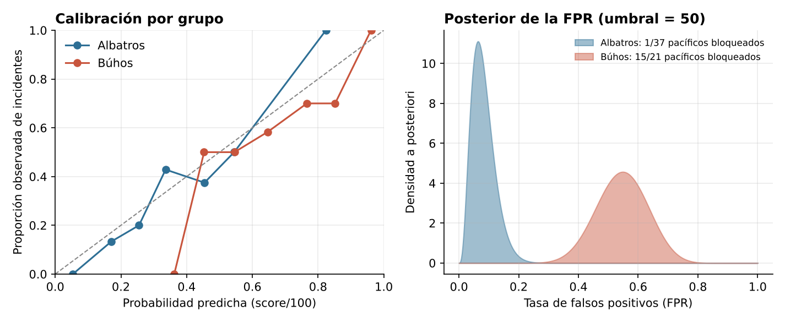

# Sesgo algorítmico: ¿un sistema de IA discrimina a una hinchada?

**Equidad algorítmica con estadística bayesiana** · R (`dplyr`, `ggplot2`) · Estadística Bayesiana, Lic. en Estadística (UNR) · 2026 · Trabajo en equipo

## Contexto
"Centinela Delta" asigna a cada hincha un score de riesgo (0–100) y le prohíbe la entrada al estadio si supera un umbral. Una ONG denuncia que **a los hinchas pacíficos de los Búhos les prohíben la entrada más seguido** que a los de los Albatros. (Caso ficticio planteado por la cátedra, con datos simulados.)

## Método
1. Prevalencia por grupo y análisis de **sesgos en los datos** de entrenamiento (vigilancia policial desigual).
2. **Gráficos de calibración** global y por grupo.
3. Matriz de confusión por grupo con umbral T = 50.
4. Modelo **Beta-Binomial** para la tasa de falsos positivos (FPR) de cada grupo; distribución a posteriori de la diferencia FPR_Búhos − FPR_Albatros.
5. **Umbrales diferenciados** por grupo (búsqueda en grilla) y transformación de los scores para igualar las FPR.
6. **Estudio de simulación** (1.000 repeticiones) para separar lo estructural de lo muestral.

## Resultados
- El score **está bien calibrado** y la exactitud global es del 70 %, pero con umbral 50 se bloquea a **15 de 21 pacíficos de los Búhos (71 %)** contra **1 de 37 de los Albatros (3 %)**.
- La probabilidad a posteriori de que el sistema castigue más a los pacíficos de los Búhos es ≈ 1: **la denuncia de la ONG tiene sustento**.
- Con umbrales distintos por grupo (≈ 51 para Albatros y ≈ 93 para Búhos) las FPR se igualan (P(FPR_B > FPR_A) ≈ 0,54), pero se pierde la calibración por grupo.
- Conclusión: cuando las prevalencias difieren, **calibración y tasas de error iguales no pueden cumplirse a la vez**; elegir es una decisión ética, no solo técnica.

## Archivos
- `codigo/centinela_delta.R`
- `datos/hinchas.csv`
